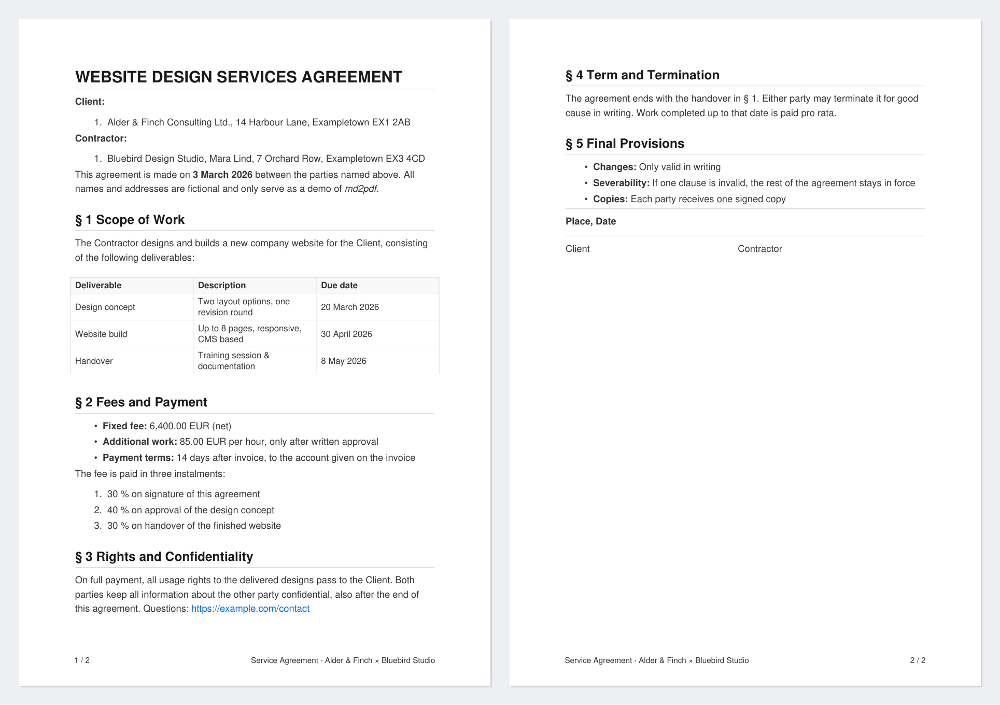

# md2pdf

**Turn a Markdown file into a clean, print-ready A4 PDF. Fully local, one Python file.**

Write contracts, agreements, offers, letters or reports in plain Markdown and get a calm, professional PDF with page numbers and a running footer.



*The pages above are [`examples/service-agreement.md`](examples/service-agreement.md) converted with one command. The result is [`examples/service-agreement.pdf`](examples/service-agreement.pdf).*

## Why local matters

Contracts, rent agreements and invoices hold names, addresses, bank details and prices. Online converters and AI tools would see all of it. md2pdf never does:

- **No network access.** The script does not open a single connection.
- **No browser, no LaTeX, no cloud.** The only dependency is [ReportLab](https://pypi.org/project/reportlab/), a mature, open-source PDF library.
- **One readable file.** About 500 lines of plain Python. You can read all of it before you trust it.
- **Plain text in, PDF out.** Your source stays a Markdown file you can diff, version and reuse as a template.

## Install

Requires Python 3.8 or newer.

```bash
git clone https://github.com/arthur671/md2pdf.git
cd md2pdf
pip install -r requirements.txt
```

## Usage

```bash
python md2pdf.py contract.md                # writes contract.pdf next to it
python md2pdf.py contract.md signed/v2.pdf  # custom output path
```

The exit code is `0` on success and `1` on error (e.g. file not found), so it works in scripts.

## What it supports

### Standard Markdown

| Markdown | Result |
|---|---|
| `# Title` | Title, 20 pt bold, with a thin rule underneath |
| `## Section` | Section heading, 16 pt bold, with rule; kept on the same page as the text that follows |
| `### Subsection` | Subsection heading, 14 pt bold, with rule (`####` to `######` render like `###`) |
| plain text | Body paragraph, 12 pt. Each line is its own paragraph |
| `**bold**` or `__bold__` | **bold** |
| `*italic*` or `_italic_` | *italic* |
| `***bold italic***` | ***bold italic*** |
| `` `code` `` | monospace (Courier) |
| `[text](https://...)` | blue, clickable link |
| `https://...` or `<https://...>` | blue, clickable link |
| `- item`, `* item`, `+ item` | bullet list |
| `1. item` or `1) item` | numbered list |
| `---`, `***` or `___` on their own line | thin horizontal rule |
| `\| a \| b \|` tables | grid table, shaded header row, header repeated on every page |

**Lists:** with no blank lines between items the list is compact; with blank lines between items it gets more air. Both look intentional.

**Special characters** such as `&`, `<`, `>`, `§`, `€`, `²`, `×` and umlauts are printed as written. You never need to escape anything.

### Extras for professional documents

#### Footer with page numbers

Put a front matter block at the very top of the file:

```markdown
---
footer:
  - \pagenum
  - \title 'Rental Agreement · Example Street 5'
---

# RENTAL AGREEMENT
...
```

This prints `1 / 4` on one side and the text on the other, on every page. The two sides swap on even pages, so printed double-sided pages mirror like a book.

| Footer item | Prints |
|---|---|
| `\pagenum` | current page / total pages, e.g. `2 / 5` |
| `\title 'Some text'` | the given text (single or double quotes) |
| `\title` | the document title (see below) |
| `\date` | today's date, e.g. `09.11.2026` |
| any other text, e.g. `Confidential` | that text as written |

How items are placed:

| Items | Odd pages | Even pages |
|---|---|---|
| 1 | centered | centered |
| 2 | first left, second right | swapped |
| 3 | first left, second centered, third right | left and right swapped |

#### Document title

The PDF's title (shown in PDF viewers' title bars, and used by a bare `\title`) is taken from, in this order:

1. `title:` in the front matter
2. the first `# Heading` (without `**` markers)
3. the file name

```markdown
---
title: Service Agreement 2026
footer:
  - \title
  - \pagenum
---
```

#### Page breaks

Any of these lines, on their own, start a new page:

```markdown
\pagebreak
\newpage
<div style="page-break-after: always;"></div>
<div style="page-break-before: always;"></div>
```

The `<div ...>` form is what many Markdown editors insert, so the same file also breaks pages correctly in their own previews.

#### Signature lines

Runs of two or more spaces are kept, so signature blocks line up:

```markdown
---

**Place, Date**

---

Client                                    Contractor
```

## Layout

- A4 paper, margins 0.75" top and bottom, 0.9" left and right
- Helvetica in dark grey (`#333333`), headings near-black, links blue (`#0366d6`), rules light grey
- Footer in 10 pt, 0.4" above the bottom edge

All of these are constants at the top of `md2pdf.py` (`PAGE_SIZE`, `*_MARGIN`, `FOOTER_Y`, the colors) if you want a different look, e.g. `PAGE_SIZE = LETTER`.

## Not supported

md2pdf deliberately stays small. These are not handled:

- images
- nested (indented) lists; indented items render as top-level items
- block quotes (`>`) and fenced code blocks (` ``` `) render as normal paragraphs
- custom fonts; text uses the built-in PDF fonts, which cover Western European characters but not e.g. Cyrillic, Greek or CJK

## License

[MIT](LICENSE)
